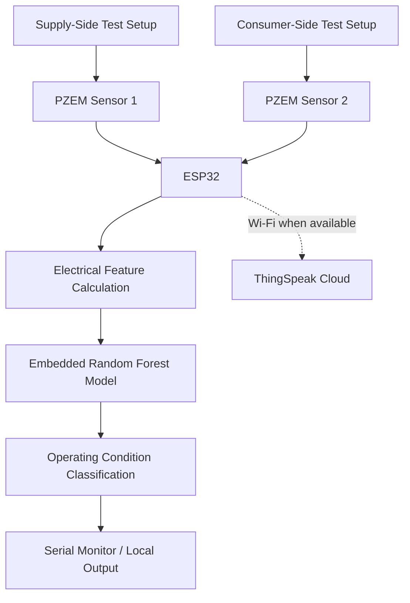

# GridEye: Edge-AI Integrated Real-Time Power Monitoring and Differential Theft Detection

## 1. Project Overview

GridEye is an IoT-based electricity monitoring prototype that integrates an ESP32 microcontroller, dual PZEM-004T v3 energy meters, and a Random Forest machine learning model.

The system monitors electrical parameters on the supply and consumer sides, calculates differences between the measurements, and classifies configured operating conditions using a model embedded in the ESP32.

The prototype can also send monitoring data to ThingSpeak when Wi-Fi connectivity is available.

## 2. Problem Statement

Electricity theft and power losses can affect the efficiency and revenue of electricity distribution systems. Continuous monitoring of electrical parameters can help identify unusual differences between supply-side and consumer-side measurements.

GridEye explores a low-cost approach that combines electrical measurement, embedded machine learning, and IoT-based monitoring to classify different operating conditions.

## 3. Objectives

- Monitor voltage, current, power, and power factor.
- Compare supply-side and consumer-side electrical measurements.
- Calculate differential features for machine learning.
- Perform Random Forest inference directly on the ESP32.
- Classify four configured operating conditions.
- Support cloud-based data logging through ThingSpeak.
- Explore electrical monitoring that can continue locally without internet connectivity.

## 4. Key Features

- Real-time electrical parameter measurement.
- Dual PZEM-004T v3 sensor integration.
- Differential voltage, current, and power calculations.
- Embedded Random Forest classification.
- Four operating-condition classes.
- Optional ThingSpeak cloud monitoring.
- Local classification without requiring continuous internet connectivity.

## 5. System Architecture

The current prototype uses two PZEM-004T v3 sensors to measure the two sides of an experimental load setup. The ESP32 calculates the input features and executes the embedded Random Forest model.



**Implementation note:** The current prototype uses two 9 W bulbs for experimental testing. Feeder-level deployment, GPS integration, Raspberry Pi processing, and large-scale distribution-network monitoring are potential future enhancements, not part of the current implemented hardware.

## 6. Operating-Condition Classification

The model classifies measurements into four configured conditions:

| Classification | Description |
|---|---|
| Direct Theft (Bypass) | Represents the configured bypass condition in the experimental setup. |
| Idle / Both OFF | Represents the condition where both test loads are switched off. |
| Normal Operation (Consumer Only) | Represents the configured consumer-only operating condition. |
| Partial Theft (Both Loads Active) | Represents the configured condition where both test loads are active. |

These labels describe the experimental conditions represented in the dataset. A model classification alone does not prove that electricity theft has occurred in a real distribution network.

## 7. Hardware Requirements

- ESP32 development board
- 2 × PZEM-004T v3 energy measurement modules
- 2 × 9 W bulbs for experimental testing
- Suitable wiring and electrical connections
- Computer for programming and monitoring

**Safety:** AC mains wiring must be performed by a qualified person using appropriately rated components and protective equipment. Do not handle exposed live conductors.

## 8. Software and Technologies

| Component | Technology |
|---|---|
| Microcontroller | ESP32 |
| Firmware | C++ / Arduino IDE |
| Electrical measurement | PZEM-004T v3 |
| Machine learning | Random Forest |
| Model training | Python, scikit-learn |
| Data processing | pandas, NumPy |
| Notebook environment | Jupyter Notebook |
| Cloud monitoring | ThingSpeak |

The ESP32 executes the embedded model using a C/C++ header. The Python training notebook is used for model development and evaluation.

## 9. Repository Structure

```text
GridEye/
├── dataset/
│   └── GridEye_combined_clean_dataset.csv
├── GridEye_ESP32_Retrained_RandomForest/
│   ├── [Existing ESP32 firmware .ino file]
│   └── [Existing model header file(s)]
├── ml_train/
│   └── [Existing Jupyter Notebook]
├── docs/
│   └── Technical_Design_Document.pdf
├── README.md
├── LICENSE
└── .gitignore
```

The bracketed entries are descriptions, not literal filenames. Keep your existing filenames unchanged. Add the `docs/` folder and Technical Design Document when that document is ready. Include `.gitignore` if you have created it.

## 10. Installation and Setup

### A. Clone the repository

```bash
git clone https://github.com/sganeshram2006-a11y/GridEye.git
cd GridEye
```

If your GitHub repository uses a different URL, replace the example above with the actual clone URL.

### B. Set up the Python environment

Install Python and the required packages:

```bash
pip install pandas numpy scikit-learn matplotlib jupyter
```

Open the Jupyter Notebook in `ml_train/` and run the cells to load the dataset, train the classifier, and evaluate its performance.

Ensure that the notebook references the dataset at:

```text
dataset/GridEye_combined_clean_dataset.csv
```

### C. Configure the ESP32

1. Install the Arduino IDE and ESP32 board support.
2. Install the required PZEM and ThingSpeak libraries.
3. Open the existing `.ino` file in `GridEye_ESP32_Retrained_RandomForest/`.
4. Ensure that the model header included by the firmware is present in the sketch directory.
5. Configure Wi-Fi credentials and the ThingSpeak API key locally if cloud logging is required.
6. Verify the sensor wiring and pin assignments against the firmware.
7. Select the correct ESP32 board and port, then compile and upload the firmware.
8. Open the Serial Monitor to observe measurements and classification outputs.

**Security:** Never commit actual Wi-Fi passwords or API keys to a public repository. Use placeholders in shared source code.

### D. Model deployment note

The Python notebook may generate a `.pkl` model for training or evaluation. The ESP32 does not load this Python model directly; it uses the embedded C/C++ model header.

Retraining the notebook does not automatically update the header. A newly trained model must be converted into the appropriate embedded representation and the firmware recompiled before it can be deployed.

## 11. Dataset and Machine Learning

The project uses `GridEye_combined_clean_dataset.csv` to train and evaluate the Random Forest classifier.

The dataset contains 275 samples across four classes:

| Class | Samples |
|---|---:|
| Normal Operation (Consumer Only) | 100 |
| Idle / Both OFF | 72 |
| Direct Theft (Bypass) | 60 |
| Partial Theft (Both Loads Active) | 43 |
| **Total** | **275** |

### Input Features

The classifier uses 11 features:

1. Supply-side voltage (`V1`)
2. Supply-side current (`I1`)
3. Supply-side power (`P1`)
4. Supply-side power factor (`PF1`)
5. Consumer-side voltage (`V2`)
6. Consumer-side current (`I2`)
7. Consumer-side power (`P2`)
8. Consumer-side power factor (`PF2`)
9. Power difference (`Power_Diff`)
10. Current difference (`Current_Diff`)
11. Voltage difference (`Voltage_Diff`)

The differential features are calculated from the sensor measurements before model inference.

### Training Methodology

The training notebook uses a Random Forest classifier with 100 trees and a fixed random seed. It uses an 80/20 stratified train-test split and five-fold cross-validation on the training portion.

Model performance should be interpreted in the context of the dataset size, data collection procedure, and possible similarities between samples. Performance on a controlled dataset does not guarantee the same results on an actual electricity distribution network.

## 12. Sample Test Cases

| Test condition | Expected classification |
|---|---|
| Both test loads switched off | Idle / Both OFF |
| Consumer-side load operating in the configured normal setup | Normal Operation (Consumer Only) |
| Configured bypass test condition | Direct Theft (Bypass) |
| Both test loads operating in the configured partial-theft setup | Partial Theft (Both Loads Active) |

These are expected classifications for the configured prototype conditions. Verify the actual output for each test case before reporting test results.

## 13. ThingSpeak Integration

When Wi-Fi and ThingSpeak are configured, the ESP32 can upload monitoring data for remote observation.

The configured data fields are:

- `V1`, `I1`, `P1`, `PF1` — supply-side measurements
- `V2`, `I2`, `P2`, `PF2` — consumer-side measurements
- `Power_Diff` — power difference
- `Current_Diff` — current difference
- `Voltage_Diff` — voltage difference

Cloud monitoring depends on network availability and correct API configuration. Local inference can operate independently of the cloud connection.

## 14. Limitations

- The current implementation is a small-scale experimental prototype.
- The dataset contains a limited number of samples representing configured test conditions.
- Similar or repeated samples may affect evaluation results.
- Real distribution networks involve technical losses, voltage variations, sensor errors, and diverse load conditions that may not be represented by the prototype.
- Classification outputs should not be treated as conclusive evidence of electricity theft.
- Cloud monitoring requires suitable network connectivity and API configuration.

## 15. Future Enhancements

- Collect a larger and more diverse dataset under controlled conditions.
- Evaluate the model on independent measurements not used during training.
- Improve robustness to sensor errors and load variations.
- Add alert mechanisms for abnormal electrical measurements.
- Explore feeder-level monitoring and location-aware reporting.
- Investigate LoRa or other communication methods for areas with limited internet connectivity.
- Validate the approach under realistic distribution-system conditions with appropriate safety procedures.

## 16. Technical Documentation

A separate Technical Design Document will describe the detailed hardware design, software workflow, system architecture, model methodology, test procedures, results, limitations, and future enhancements.


## 17. License

This project is licensed under the **MIT License**. See the [LICENSE](LICENSE) file for details.

## 18. Acknowledgements

This project was developed as an academic engineering prototype exploring the integration of electrical measurement, embedded systems, IoT, and machine learning for electricity monitoring.

---

**Project:** GridEye — Edge-AI Integrated Real-Time Power Monitoring and Differential Theft Detection

**GitHub Repository:** [sganeshram2006-a11y/GridEye](https://github.com/sganeshram2006-a11y/GridEye)
